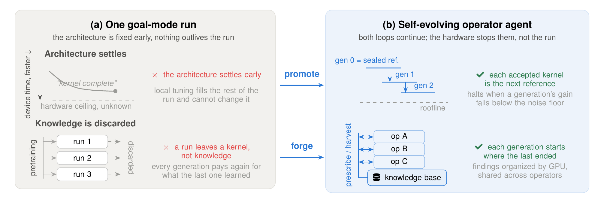
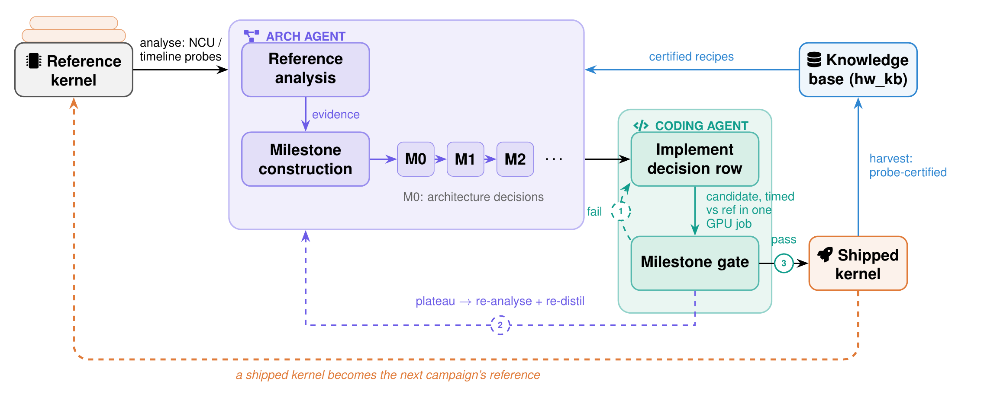

<div align="center">

# RSI-Kernel-Tune: Self-Evolving Kernels Catching and Surpassing Experts and Agents

**English** | [中文](README_zh.md)

[](https://arxiv.org/abs/2611.04998)
[](#quick-start)
[](docs/design/v1-launch.md)

[](LICENSE)
[](pyproject.toml)



</div>

this project is a **self-evolving GPU kernel agent** that starts from a **reference kernel**.
It reads the reference's architecture by running, timing and profiling it, turns that into an
architecture-first milestone curriculum that a coding agent implements, and **promotes every
accepted kernel to the next reference**, so optimization keeps going past the best known
implementation. Findings certified by a hardware probe accumulate in a
**knowledge base shared across operators**. In the paper, across 27 operators on Hopper and
Blackwell, RSI-Kernel-Tune matches or beats **18 of 22 expert-library kernels** (FlashAttention-4,
cuDNN, DeepGEMM and others) and **all 7 published kernels** of three kernel-generation systems,
by up to **+170.6%** (+39.4% geometric mean). The kernels are released in [`kernels/`](kernels/).

this project is part of the **Forge family**, together with
[ForgeTrain](https://github.com/OpenBMB/ForgeTrain) and
[ForgeStencil](https://github.com/OpenBMB/ForgeStencil).

## FlashInfer-Bench scoreboard

**B200 collection target to beat** · **0.940633 SOL** on the public v1.1 board, checked 2026-11-26. [Collection leaderboard](https://research.nvidia.com/benchmarks/sol-execbench/leaderboard/collection/4/B200)

Contributors should push their **best candidate so far** to `flashinfer-bench/<operator>/submission.py` and sanitized benchmark evidence to `reports/flashinfer-bench-results/<operator>/`. The collection coordinator can then archive the `flashinfer-bench/` tree for the final bulk submission. [Submission format](https://research.nvidia.com/benchmarks/sol-execbench/blog/submission-guide)

**Push an update when each benchmark result is ready.** Update only your operator’s row in this README section. Include the device, outcome, passed/total workloads, and submission ID or evidence link. For your best complete B200 result, refresh the public operator board and record the leader’s SOL score, your candidate’s current public rank, the signed gap, and the UTC check time. Calculate the gap as leader SOL minus candidate SOL. A positive gap means the candidate is behind. Use `Unranked (private)` for a private candidate. For GB300, pending, or invalid runs, use the latest-run column and preserve the previous best. Use a branch and PR if you lack direct write access.

**Shared GPU** · Acquire the common GPU lock and check for other compute jobs before running. Wait when another agent is using the device and recheck before starting. Repeat timings affected by contention.

| Operator | B200 leader SOL | Campaign best B200 SOL | Public rank | SOL gap to leader | Latest run and evidence | Best candidate |
|---|---:|---:|---:|---:|---|---|
| [001_fused_add_rmsnorm_h2048](https://research.nvidia.com/benchmarks/sol-execbench/leaderboard/kernel/210/B200) | 0.721444 | — | — | — | GB300 tuned packed CUDA passed 7/7 · B200 retry waiting for shared capacity · [evidence](reports/flashinfer-bench-results/001_fused_add_rmsnorm_h2048/README.md) | [GB300 only](flashinfer-bench/001_fused_add_rmsnorm_h2048/submission.py) |
| [002_fused_add_rmsnorm_h4096](https://research.nvidia.com/benchmarks/sol-execbench/leaderboard/kernel/211/B200) | 0.975342 | — | — | — | Pending | — |
| [003_fused_add_rmsnorm_h7168](https://research.nvidia.com/benchmarks/sol-execbench/leaderboard/kernel/212/B200) | 0.863498 | — | — | — | Pending | — |
| [004_gemm_n128_k2048](https://research.nvidia.com/benchmarks/sol-execbench/leaderboard/kernel/213/B200) | 0.894803 | — | — | — | Pending | — |
| [005_gemm_n256_k7168](https://research.nvidia.com/benchmarks/sol-execbench/leaderboard/kernel/214/B200) | 0.915728 | — | — | — | Pending | — |
| [006_gemm_n2048_k4096](https://research.nvidia.com/benchmarks/sol-execbench/leaderboard/kernel/215/B200) | 1.000000 | — | — | — | Pending | — |
| [007_gemm_n4096_k4096](https://research.nvidia.com/benchmarks/sol-execbench/leaderboard/kernel/216/B200) | 1.000000 | — | — | — | Pending | — |
| [008_gemm_n4096_k14336](https://research.nvidia.com/benchmarks/sol-execbench/leaderboard/kernel/217/B200) | 1.000000 | — | — | — | Pending | — |
| [009_gemm_n5120_k2048](https://research.nvidia.com/benchmarks/sol-execbench/leaderboard/kernel/218/B200) | 1.000000 | — | — | — | Pending | — |
| [010_gemm_n6144_k4096](https://research.nvidia.com/benchmarks/sol-execbench/leaderboard/kernel/219/B200) | 1.000000 | — | — | — | Pending | — |
| [011_gemm_n28672_k4096](https://research.nvidia.com/benchmarks/sol-execbench/leaderboard/kernel/220/B200) | 1.000000 | — | — | — | Pending | — |
| [012_gqa_paged_decode_h32_kv4_d128_ps1](https://research.nvidia.com/benchmarks/sol-execbench/leaderboard/kernel/221/B200) | 0.992633 | — | — | — | GB300 only · 48/48 CLI pass · 14.815 µs geomean · [evidence](reports/flashinfer-bench-results/012_gqa_paged_decode_h32_kv4_d128_ps1/README.md) | [Provisional](flashinfer-bench/012_gqa_paged_decode_h32_kv4_d128_ps1/submission.py) |
| [013_gqa_paged_decode_h32_kv8_d128_ps1](https://research.nvidia.com/benchmarks/sol-execbench/leaderboard/kernel/222/B200) | 0.979799 | — | — | — | Pending | — |
| [014_gqa_paged_prefill_causal_h32_kv4_d128_ps1](https://research.nvidia.com/benchmarks/sol-execbench/leaderboard/kernel/223/B200) | 0.995919 | — | — | — | GB300 only · official v2 30/30 · B200 upload rate-limited · [evidence](reports/flashinfer-bench-results/014_gqa_paged_prefill_causal_h32_kv4_d128_ps1/record.json) | [GB300 provisional](flashinfer-bench/014_gqa_paged_prefill_causal_h32_kv4_d128_ps1/submission.py) |
| [015_gqa_paged_prefill_causal_h32_kv8_d128_ps1](https://research.nvidia.com/benchmarks/sol-execbench/leaderboard/kernel/224/B200) | 0.996676 | — | — | — | Pending | — |
| [016_gqa_ragged_prefill_causal_h32_kv4_d128](https://research.nvidia.com/benchmarks/sol-execbench/leaderboard/kernel/225/B200) | 0.965848 | — | — | — | Pending | — |
| [017_gqa_ragged_prefill_causal_h32_kv8_d128](https://research.nvidia.com/benchmarks/sol-execbench/leaderboard/kernel/226/B200) | 0.959860 | — | — | — | Pending | — |
| [018_mla_paged_decode_h16_ckv512_kpe64_ps1](https://research.nvidia.com/benchmarks/sol-execbench/leaderboard/kernel/227/B200) | 0.994987 | — | — | — | Pending | — |
| [019_mla_paged_prefill_causal_h16_ckv512_kpe64_ps1](https://research.nvidia.com/benchmarks/sol-execbench/leaderboard/kernel/228/B200) | 0.998735 | — | — | — | Pending | — |
| [020_moe_fp8_block_scale_ds_routing_topk8_ng8_kg4_e32_h7168_i2048](https://research.nvidia.com/benchmarks/sol-execbench/leaderboard/kernel/229/B200) | 1.000000 | — | — | — | Pending | — |
| [021_rmsnorm_h128](https://research.nvidia.com/benchmarks/sol-execbench/leaderboard/kernel/230/B200) | 0.799820 | — | — | — | Pending | — |
| [022_rmsnorm_h512](https://research.nvidia.com/benchmarks/sol-execbench/leaderboard/kernel/231/B200) | 0.818143 | — | — | — | Pending | — |
| [023_rmsnorm_h1536](https://research.nvidia.com/benchmarks/sol-execbench/leaderboard/kernel/232/B200) | 0.929768 | — | — | — | Pending | — |
| [024_rmsnorm_h2048](https://research.nvidia.com/benchmarks/sol-execbench/leaderboard/kernel/233/B200) | 0.815575 | — | — | — | Pending | — |
| [025_rmsnorm_h4096](https://research.nvidia.com/benchmarks/sol-execbench/leaderboard/kernel/234/B200) | 0.904060 | — | — | — | Pending | — |
| [026_rmsnorm_h7168](https://research.nvidia.com/benchmarks/sol-execbench/leaderboard/kernel/235/B200) | 0.937995 | — | — | — | Pending | — |

## News

- 🛠️ **[2026-11]** Claude Code skill `forge-start` released: type `/forge-start` and it sets up
  and launches (or resumes) a RSI-Kernel-Tune run for you. See
  [integrations/claude-code](integrations/claude-code/README.md).
- 📄 **[2026-11]** RSI-Kernel-Tune paper release: [arXiv:2611.04998](https://arxiv.org/abs/2611.04998).
- 📄 **[2026-10]** JustGoal paper release: [arXiv:2610.36434](https://arxiv.org/abs/2610.36434).
- 🏆 **[2026-10]** We reached **#1** on the FlashInfer-Bench leaderboard of NVIDIA
  [SOL-ExecBench](https://research.nvidia.com/benchmarks/sol-execbench).
- 🏆 **[2026-10]** We reached **#1** on Huawei CANN-Bench (Ascend A3).
- 🏆 **[2026-10]** We also reached **#1** on Ascend 950DT on the
  [CANN-Bench leaderboard](https://cannbench.com/leaderboard).

## TODO

Planned for **RSI-Kernel-Tune v1.5**:

- [ ] **Shape clustering**: group the shapes of a task into clusters and optimize per cluster,
  so one run can cover a wide range of shapes.
- [ ] **A much simpler harness**: fewer moving parts in the loop and a smaller configuration
  surface.
- [ ] **One repository with [ForgeTrain](https://github.com/OpenBMB/ForgeTrain) and
  ForgeMegaKernel** (in progress).

## Highlights

- 🔁 **Self-evolution: always one step past the reference.** Every accepted kernel becomes the
  next run's reference, so each generation has to beat the one before it, and the chain stops
  only when the hardware gives no more (a gain below the noise floor). In the paper
  every promoted reference was beaten again, by up to **+9.9%** a generation, including `/goal`
  agent kernels already far ahead of the expert library: GDN prefill ends **+100%** over
  FlashInfer, GQA attention forward **+29%** over FlashAttention-4 (`scripts/self_evolve.py`).
- 🗺️ **Architecture-first curriculum: the error-prone decisions are settled first.** The decisions
  that are easiest to get wrong and most expensive to change later, the architecture (kernel
  split, tile shapes, warp roles, register and shared-memory budget) and the orchestration (what
  stays resident, the issue order, which work hides under which), are all made in the first
  milestone, **M0**, and frozen once its gate passes. Later milestones `M1 → Mk` only tune inside
  that structure, each closed by a gate of correctness, performance and mechanism lines. When
  measurement shows a limit only a new structure can lift, the arch agent goes back and revises
  M0 instead of letting later milestones work around it.
- 📚 **A knowledge base that outlives the run.** Hardware mechanisms certified by a GPU probe are
  stored per GPU architecture (`hw_kb/`) and prescribed to later operators.

## 🤖 Set it up with a coding agent

Clone this repository, then paste this into Claude Code (or any coding agent that can run shell
commands) started in the clone:

```text
Read README.md in this directory and set up RSI-Kernel-Tune on this machine:
install it in a virtual environment, write local.env for my GPU (this
machine, or the ssh host I name) and run `forge new tasks/rmsnorm --dry-run`.
Show me the plan it prints.
```

## Quick Start

**Requirements.** The machine you run `forge` on: Linux or macOS, Python ≥ 3.11, git, and the
[Claude Code](https://docs.claude.com/en/docs/claude-code/overview) CLI (logged in, or an
`ANTHROPIC_API_KEY`); tmux if a task has no reference. The GPU machine (the same one, or an ssh
host): an NVIDIA Hopper (`sm90`) or Blackwell (`sm100`) GPU, `python3` with a CUDA build of
PyTorch and, for CuTe DSL tasks, `nvidia-cutlass-dsl`; Nsight Compute (`ncu`) is recommended,
and without it a run proceeds on timings alone.

**Clone and run (the short version).**

```bash
git clone https://github.com/ChaseZhang-ai/RSI-Kernel-Tune.git && cd RSI-Kernel-Tune
python3 -m venv .venv && source .venv/bin/activate
pip install -e .                 # torch + safetensors come with it
cp local.env.example local.env   # say where the GPU is (local or an ssh host)
forge --help                     # built-ins + the 11 extension commands
```

[`docs/quickstart.md`](docs/quickstart.md) is the same path in more detail: the checks that
need no GPU at all, the SOL-ExecBench campaign loop, and what is (and is not) verified so far.

**1. Install**

```bash
cd RSI-Kernel-Tune                   # a clone of this repository
python3 -m venv .venv && source .venv/bin/activate
pip install -e .                 # installs torch + safetensors too
pip install nvidia-cutlass-dsl   # recommended, see below
forge --version                  # rsi_kernel_tune 0.1.0
```

The coding agent works offline; installing `nvidia-cutlass-dsl` next to this project is how it
reads the CuTe DSL API it writes against.

**2. Say where the GPU is**

```bash
cp local.env.example local.env
# FK_DELIVERY=local -> the GPU on this machine (FK_GPU picks the device)
# FK_DELIVERY=ssh   -> REMOTE_HOST (an ssh alias that logs in without a
#                      prompt) and REMOTE_WORKDIR (a directory on it)
```

**3. Run the example task**: fuse a PyTorch RMSNorm (nine kernel launches a call) into one CuTe DSL
kernel on a Blackwell GPU (set `arch = "sm90"` in `task.toml` for Hopper).

```bash
forge new tasks/rmsnorm --dry-run                       # check the task, print the plan
forge new tasks/rmsnorm                                 # -> .artifacts/rmsnorm_<id>
tmux new -s forge 'forge run .artifacts/rmsnorm_<id>'   # a run takes hours
forge status .artifacts/rmsnorm_<id>                    # progress
forge run .artifacts/rmsnorm_<id>                       # continue after an interruption
```

`forge run` exits 0 when the run reaches its target -- the loop stopped on it, or the final
confirmation of the best kernel meets it -- and 2 otherwise.

**Expected output.** The run writes the correctness judge, calibrates it against the reference,
measures the reference, distils a milestone, and iterates until the kernel is 1.2× the
reference or the budget ends. It finishes with `.artifacts/rmsnorm_<id>/report.md` and the best
kernel in `.artifacts/rmsnorm_<id>/best/kernel.py`. On a B200 our run of this example stopped at **5.2×** the
PyTorch reference after about 1.5 hours:

```text
- task: rmsnorm (source mode)
- best: 77856a9d9561 -- device median 0.0307 ms, 5.2363x the reference
- kernel: best/kernel.py
```

> Full launch reference → [docs/design/v1-launch.md](docs/design/v1-launch.md)

## Board commands: the SOL-ExecBench campaign loop

The extensions turn the loop into a board campaign. Each command is one step of the chain
below; `forge <command> --help` is the reference, this table is the map. A step's "needs"
column says what the step cannot do without.

| # | Step | Command | What it does | Needs |
|---|---|---|---|---|
| 1 | know the target | `forge target probe [--remote]`, `forge target check`, `forge target show`, `forge target compile-check <submission.py>` | measure the development machine (GPU, clocks, stack, three smokes), compare it with `target/B200.json`, render the profile the agents read, and compile one candidate for the graded GPU | a GPU for `probe`, `nvcc` for `compile-check` |
| 2 | find a starting point | `forge lib build`, `find <problem>`, `show <id>`, `score <problem> --card …`, `baselines <problem>`, `cover`, `adapt <problem> --seed …`, `fetch` | build and query the reference library (`kernel_library/`, 134 entries from permissively licensed sources), measure entries with `forge bench`, generate torch-only baselines, adapt a reference into this problem's `submission.py` | `forge bench` for `score`/`adapt` |
| 3 | start from an existing kernel | `forge init <op> --leaderboard … --init-kernel <file> --prior <path>`, `forge prior build <op>` | seed the card's kernel file with a working implementation (byte-identical), copy references into the card's `prior/`, and write the `prior.md` manifest a run reads through `{PRIOR_PATH}` | — |
| 4 | measure one candidate | `forge bench <task> --candidate <kernel.py\|solution.json>` (`compare`, `best-of` to combine readings) | one candidate through the loop's own GPU job on the frozen card: the card's clock, the card's judge, per-workload S, cold start; `--mode target` is the compile check only | a GPU for `--mode dev` |
| 5 | know the hardware's limit | `forge calibrate`, `forge roofline tasks/<op> [--calibration …] [--cost-model … \| --estimate]` | measure this machine's peaks (six self-checked probes, delivery through the job path), then write each workload's floor, bottleneck class, flags and distance into the `{ROOFLINE_PATH}` context file | a GPU for `calibrate`; a model for `--estimate` |
| 6 | optimize | `forge run`, `forge evolve <task> --lineages N --generations G` | the two-layer loop; `evolve` runs N populations of it, migrates the best into stalled lineages, keeps a refuge and archives every correct version; the `[budget]` keys cap what the teacher may eat | a model, a GPU |
| 7 | specialise per shape | `forge shapes plan <task>`, `run`, `compose` (`--also` folds other exports in) | cluster a card's workloads by size, run each cluster, cross-evaluate the candidates per workload, and compose one `submission.py` that dispatches to the per-workload winner | a model/GPU for `run` |
| 8 | keep the lessons | `forge lessons harvest <run>`, `query`, `render <problem> --out lessons.md`, `lint`, `stats` | mechanically extract a finished run into `op_kb/` records (kept/failed iterations, recon verdicts, usage) and render one markdown file the next run of the family reads through `{LESSONS_PATH}` | — |
| 9 | orchestrate the board | `forge campaign targets`, `plan --pilot …`, `run`, `status`, `report`, `export <problem>`, `pack --track <t>`, `sync`, `tools` | the gap list from the board snapshot, a resumable per-problem campaign over `forge run`/`forge evolve`/`forge shapes`, the local-vs-board ratio ledger, one track's upload archive | a model/GPU for `run`, a dataset for `plan --dataset` |
| 10 | submit and read back | `forge board whoami`, `submit <problem> <submission.py>`, `status`, `result <id>`, `publish <id>`, `submit-collection <track> <zip>`, `import <campaign>` | the board client: single-problem submissions (instant for the first five a day), track archives (two a day, ~6 h), result read-back, and import into the campaign ledger | `SOL_EXECBENCH_TOKEN` in the environment only |

Every export goes through the **integrity gates**: `forge export` and the campaign's export
refuse a file with a block-level static finding (environment writes, hidden state, absolute
paths, architecture literals; `docs/integrity.md`), require the licence/notice banner,
re-check the candidate on fresh inputs (`rsi_kernel_tune.integrity.multiseed`) and refuse a cold
start past `rsi_kernel_tune.benchx.api.COLD_START_BUDGET_S`.

Run-time mechanisms the commands rely on: the four run context files
(`{TARGET_PROFILE_PATH}`, `{ROOFLINE_PATH}`, `{LESSONS_PATH}`, `{PRIOR_PATH}`) carry measured
data into every prompt; the throughput governor (`[budget]` in `task.toml`, the ledger
`governor_ledger.jsonl`, `forge status` / `report.md`) keeps the teacher from starving the
student; the agent backend is a plugin (default: teacher = Codex, student = Codex) and
every turn's tokens and cost land in `agent_usage.jsonl` (`## Agent usage` in `report.md`).

Languages: `task.toml` accepts `cutedsl`, `cuda-sol` and `triton`; a Triton card is made with
`forge init … --language triton`, and `python -m rsi_kernel_tune.triton_check <kernel.py>` is the
standalone target compile check for a Triton kernel.

## How It Works

<div align="center">

</div>

A run has two nested loops. In the **inner loop** the coding agent implements one decision row of
the milestone at a time, and one GPU job judges correctness, times the candidate against the
reference and profiles it; a correctness failure is reverted. In the **outer loop** the arch
agent re-enters after iterations without a new best, at an exhausted decision graph or at a gate
impasse: it prices levers, runs verdict probes and revises the curriculum. A shipped kernel can
become the next run's reference, and what probes certify feeds the knowledge base.

Three artifacts carry the work, and their boundary is what keeps the reference's code out of the
kernel: the per-operator **milestone** (decisions, parameters and contracts, never an
implementation body), the **hardware knowledge base** (operator-agnostic mechanisms, the only
artifact with code), and the **meta-milestone** ([`meta_milestone.md`](meta_milestone.md)), the
distillation policy. The paper's terms map onto the code as follows:

| Paper | In this repository |
|---|---|
| arch agent | the *teacher* (`[agent.teacher]` in `task.toml`) |
| coding agent | the *student* (`[agent.student]`) |
| campaign | a run, `.artifacts/<op>_<id>/` |
| knowledge base | `hw_kb/cutedsl/` (CuTe DSL), `hw_kb/cuda/` (CUDA C++) |

> Design notes → [docs/design/milestone-distillation.md](docs/design/milestone-distillation.md),
> milestone format → [docs/milestones-template.md](docs/milestones-template.md)

## Writing a Task

`forge init <op>` copies `tasks/_template/` to `tasks/<op>/`, three files to fill in:

- `description.md`: the operator, completely (signature, semantics, legal inputs). The teacher
  writes the correctness judge from this file alone.
- `shapes.json`: the shapes to optimize for; every shape and every input group is judged and timed.
- `task.toml`: language (`cutedsl` or `cuda`), GPU architecture, the reference, the target, the
  models, the budget.

The reference decides the mode:

| `[reference]` | Mode | What the teacher sees |
|---|---|---|
| `run` + `source` | `source` | the reference's source and its hardware behavior |
| `run` only, or `blackbox = true` | `blackbox` | hardware behavior only |
| (none) | generate | a `/goal` session writes a reference first |
| `[leaderboard]` instead | leaderboard | the board's problem, judge and clock |

A task writes only what differs from `global_config/`, the bottom layer every task is merged
onto, as in ForgeTrain: `models.toml` sets `[agent]` (`backend`, `provider`, `model`, `effort`,
`timeout_s`; `[agent.teacher]` / `[agent.student]` for one agent), `loop.toml` sets `[target]`
and `[budget]`, and `backends.toml` lists the API endpoints a `provider` other than `native`
can name, with the key read from `local.env`.

**One objective: get faster — the destination is #1 on this kernel's SOL-ExecBench board.**
Everything is built around that. There are no wall-clock or round-count budgets by default
(`[budget]` is 0 = unbounded; a run stops when it actually meets the target, never when a
clock runs out). All references are open by default — the reference implementation, prior
kernels, the KB, and the web are there to be read and reused; there is no sealed lane and no
anti-"cheating" stance. `forge board submit` has no confirmation and no score threshold —
a kernel that looks good, or that you simply want to measure, is submitted immediately; the
board's own evaluation is the authority. Dev hardware raises specific divergences on the
graded machine (`target/B200.json`): FP4 ~1.5x faster on the development GPU (15 vs 10
PFLOPS), SFU ~2.1x (10.7 vs 5.0 TeraExp/s), SM count 148 vs up-to-160, and cubins aren't
binary-compatible between the two — submission sources must derive their gencode from the
device and never name an architecture. **Codex for both roles** (`sol6.2`, reasoning
effort `high`) unless a task overrides one of them (e.g. Claude when a /goal session is
needed).

## Self-Evolution

```bash
python scripts/self_evolve.py tasks/<op> [--step 1.05] [--max-gen N]
```

Each generation is an ordinary run (`forge new`, then `forge run`). When it ends with a confirmed
best kernel faster than its reference by more than the noise floor, the script writes the next
generation as a new task `tasks/<op>-g<k>/`: the same `task.toml`, `description.md` and
`shapes.json` (and `inputs/`), the best kernel copied into its `reference/`, and a target of `--step`
(default 1.05) times the new reference's speed. Each generation's task is self-contained, so it can be
committed and rerun elsewhere. The chain stops only when the hardware gives no more: at a generation
whose gain is within the noise floor (the spread of that generation's same-job confirmation ratios,
at least 1.5%), or at one that ends without a confirmed best kernel. There is no generation cap
unless you set `--max-gen`. The
promoted kernel carries its source, so every generation after the first runs in `source` mode: the
teacher reads the previous best, the student never does. (CuTe DSL tasks only.)

## Leaderboard Tasks

```bash
forge init rms --leaderboard flashinfer-bench --dataset <flashinfer-trace> \
    --definition <definition> --workload <workload>
forge new tasks/rms                                  # -> .artifacts/rms_<id>
forge run .artifacts/rms_<id>
forge export .artifacts/rms_<id> --out solution.json
```

The task freezes the board's problem: inputs, tolerance and stopwatch follow the board's own
evaluation code. → [docs/leaderboards.md](docs/leaderboards.md)

## Kernels

[`kernels/`](kernels/) releases the kernels RSI-Kernel-Tune generated in the paper (24 kernels in CuTe
DSL, on H100 and B200) and one generated after it (the DeepSeek-V4.1 fused sparse-attention
prefill in CUDA C++, 1.10× FlashMLA on B200). They are grouped by operator type, then by operator
and GPU:

| Directory | Operators |
|---|---|
| [`attention/`](kernels/attention/) | attention forward (with its self-evolution generations) and backward, GQA and MLA paged decode, MLA paged prefill |
| [`sparse_attention/`](kernels/sparse_attention/) | DeepSeek sparse attention (DSA) backward, score recompute and indexer backward; DeepSeek-V4.1 fused prefill |
| [`linear_attention/`](kernels/linear_attention/) | Gated DeltaNet prefill forward and backward, varlen prefill; recurrent Kimi Delta Attention prefill |
| [`gemm/`](kernels/gemm/) | dense 16-bit GEMM, FP8 GEMM, FP8 × FP4 grouped GEMM (MoE) |
| [`conv/`](kernels/conv/) | Conv2d weight and data gradient, Conv3d forward |

The speedup of each kernel, what it was compared against, and the environment it ran in are listed
in [kernels/README.md](kernels/README.md).

## Environment

The paper's experiments ran on the following GPUs and software. Most campaigns used the main
image of each GPU:

| | Hopper | Blackwell |
|---|---|---|
| GPU | NVIDIA H100 80 GB HBM3 SXM, 132 SMs (`sm_90a`) | NVIDIA B200, 180 GB HBM3e, 148 SMs (`sm_100a`), 1000 W, max SM clock 1965 MHz |
| Driver | 550.90.07 | 580.105.08 |
| CUDA toolkit | 12.8 | 13.1 (`nvcc` 13.1.115) |
| PyTorch | 2.6.0a0 (NGC 25.01) | 2.10.0+cu130 |
| CuTe DSL (`nvidia-cutlass-dsl`) | 4.4.2 | 4.4.2 |
| Nsight Compute (`ncu`) | 2025.1 | 2025.4.1 |
| cuDNN | 9.7 | 9.19.1 |

Some campaigns ran on a second image: on H100, CUDA 13.1, PyTorch 2.10 (NGC 25.12) and CuTe DSL
4.6.1; on B200, CUDA 13.0, PyTorch 2.13 and CuTe DSL 4.6.2 with Nsight Compute 2025.3.1.
Every reported gain times the reference and the candidate in the same GPU job, so the
comparison does not depend on which image a campaign used.

## Repository Layout

The layout follows ForgeTrain's:

```text
src/rsi_kernel_tune/     the harness: CLI, tasks and runs, the loop, GPU jobs
global_config/       the bottom config layer: models.toml, loop.toml, backends.toml
tasks/               <op>/: task.toml, description.md, shapes.json, reference/;
                     _template/ (what `forge init` copies), rmsnorm/ (ready to run)
.artifacts/          runs, gitignored: <op>_<id>/{run.json, ws/, report.md, best/, ...}
skills/              the agents' tools, one SKILL.md + scripts each, mirrored into
                     the agent's .claude/skills/ before every turn
meta/                teacher and student prompts (meta/cuda/: CUDA C++)
hw_kb/               the hardware knowledge base (cutedsl/, cuda/), by GPU architecture
docs/                design notes, milestone template, leaderboards, KB
scripts/             agent launcher, /goal driver, self-evolution
tests/               pytest suite (CPU only)
kernels/             kernels generated by RSI-Kernel-Tune, by operator type
integrations/        claude-code/forge-start/: the Claude Code launch skill (for you, not the agents)
```

## Contributing

Contributions are welcome: bug reports, feature requests, pull requests, documentation and
translations. Run the tests before sending a change (`pip install pytest torch safetensors`,
then `pytest`; the suite needs no GPU). A knowledge-base
entry needs a GPU probe that certifies it; see [docs/kb-harvest.md](docs/kb-harvest.md).

## Limitations

- **A reference helps most.** Given only a PyTorch implementation and a device-time number, the
  paper's ablation stalls on all three operators tested; RSI-Kernel-Tune surpasses an implementation
  that exists more reliably than it writes the first one.
- **A plateau is an estimate, not a proof.** Self-evolution stops at the same-job noise floor:
  the loop found nothing more, which does not mean nothing more exists.
- **Coverage.** Four operator families on two NVIDIA GPU generations; sparsity patterns and memory
  hierarchies unlike these are untested.
- **Cost.** A run is hours of GPU time and frontier-model usage, and the agents run with
  permissions bypassed inside a policy the driver writes; run it on a machine meant for it.

## Citation

If you use RSI-Kernel-Tune, please cite our paper:

<details>
<summary>BibTeX</summary>

```bibtex
@misc{chen2026rsi_kernel_tune,
  title  = {RSI-Kernel-Tune: Self-Evolving Kernels Catching and Surpassing Experts and Agents},
  author = {Chen, Yaojian and Peng, Dazhi and Zheng, Yiyun and Zhu, Zhui and Xiang, Shengye
            and Li, Leshan and Li, Zhen and Deng, Xianglong and Sun, Haojun and He, Qingfeng
            and Li, Shangzhan and Shen, Yifei and Gan, Lin and Li, Yuxuan and Han, Xu
            and Liu, Zhiyuan},
  year   = {2026},
  eprint = {2611.04998},
  archivePrefix = {arXiv},
  url    = {https://arxiv.org/abs/2611.04998}
}
```

</details>

## License

Apache License 2.0. See [LICENSE](LICENSE). The leaderboard evaluator adapts code from
FlashInfer-Bench and SOL-ExecBench (both Apache-2.0); see [NOTICE](NOTICE).

## Acknowledgments

RSI-Kernel-Tune builds on [CUTLASS and CuTe DSL](https://github.com/NVIDIA/cutlass),
[Nsight Compute](https://developer.nvidia.com/nsight-compute),
[Claude Code](https://docs.claude.com/en/docs/claude-code/overview),
[FlashInfer-Bench](https://huggingface.co/datasets/flashinfer-ai/flashinfer-trace) and
[SOL-ExecBench](https://huggingface.co/datasets/nvidia/SOL-ExecBench), and measures itself against the
expert kernels of FlashAttention, DeepGEMM, FlashMLA, FlashInfer, cuDNN and cuBLAS.
