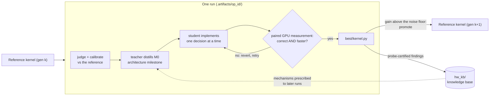
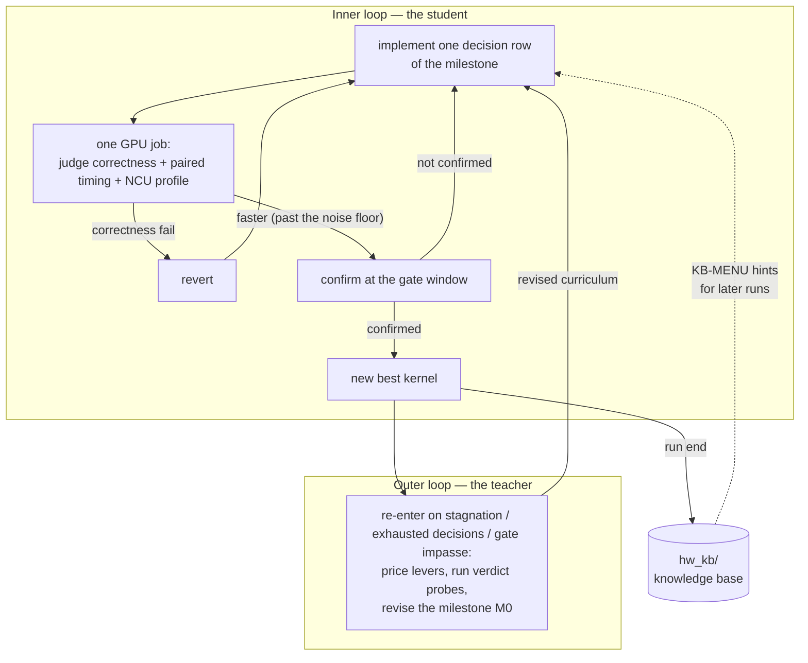

# RSI-Kernel-Tune

[](#quick-start)
[](docs/options.md)
[](#the-configuration-page-rsi-runtoml)
[](LICENSE)
[](https://www.python.org)

RSI-Kernel-Tune is a **self-evolving GPU kernel-optimization framework**. You give it an
operator (a description, a reference implementation, inputs, a correctness tolerance); a
**teacher** agent distills the reference's architecture into a milestone curriculum, a
**student** agent implements kernels against it, and every candidate is judged by paired
measurement on real hardware. Every accepted kernel becomes the **next run's reference**, so
optimization keeps going past the best known implementation, and hardware-certified findings
accumulate in a **knowledge base shared across operators**.



This repository is a fork of [OpenBMB/ForgeKernel](https://github.com/OpenBMB/ForgeKernel)
(baseline commit `5030503`, Apache-2.0); the upstream obligations are preserved in
[LICENSE](LICENSE) and [NOTICE](NOTICE). What the fork adds is listed
[below](#what-this-fork-changes-over-upstream).

## Highlights

- 🔁 **Self-evolution.** Every accepted kernel becomes the next reference; the chain stops
  only when gains fall below the measured noise floor.
- 🗺️ **Architecture-first.** The expensive-to-change decisions (kernel split, tile shapes,
  warp roles, persistence) are settled and hardware-probed in milestone M0 before any tuning.
- 📏 **Honest measurement.** Mirror-ordered paired timing, an fp64 error-ratio precision
  gate, fresh-input rechecks, and a replay probe that catches memoization cheats.
- 🛡️ **Red-team tested anti-cheat.** A cheat-fixture suite (cache replay, seed probing,
  stream injection, timer tampering) runs in CI and must be caught by the defenses.
- 📚 **A knowledge base that outlives the run.** Only probe-certified mechanisms enter
  `hw_kb/`; falsified levers are remembered too.

## What this fork changes over upstream

| Area | What was added | Where |
|---|---|---|
| Measurement statistics | Resolvable noise floor, mirror-ordered paired windows, gate/plateau window contracts | WP1/9/15 |
| Priced search | Every lever carries a measured price; sweeps eliminate losers; runner-up pool + stagnation restarts; sub-noise levers compound separately | WP4/10/16 |
| Declared precision | `compute_dtype` (fp32/tf32/bf16/fp16/fp8) is your declaration; the system never optimizes below it | WP22, [docs/compute-dtype.md](docs/compute-dtype.md) |
| Two-lane contract | `STRICT` (default, memoization forbidden) vs opt-in `MEMO` industrial lane | M3, [docs/industrial-lane.md](docs/industrial-lane.md) |
| Anti-cheat hardening | Replay probe (the G1 fix), red-team suite, measure-side sentinels | WP20/20R/29 |
| Process speed | Eval+NCU merged into one job, SPRT early stop, content-keyed build cache, background measurement lane | WP11/19 |
| Audit mode | `RKT_PROFILE=baseline` turns every fork-added verdict-changing mechanism off to emulate upstream-era measurement | [docs/design/v1-launch.md](docs/design/v1-launch.md) |

Full history: [CHANGELOG.md](CHANGELOG.md).

## 🤖 Set it up with a coding agent

Clone this repository, then paste this into Claude Code (or any coding agent that can run
shell commands) started in the clone:

```text
Read README.md in this directory and set up RSI-Kernel-Tune on this machine:
install it in a virtual environment, write local.env for my GPU (this
machine, or the ssh host I name) and run `rsi-kernel-tune new tasks/rmsnorm --dry-run`.
Show me the plan it prints.
```

## Quick start

**Requirements.** The machine you run `rsi-kernel-tune` on: Linux or macOS, Python ≥ 3.11,
git, and the Claude Code CLI (logged in, or an `ANTHROPIC_API_KEY`). The GPU machine (the
same one, or an ssh host): an NVIDIA Hopper (`sm90`) or Blackwell (`sm100`) GPU, `python3`
with a CUDA build of PyTorch and, for CuTe DSL tasks, `nvidia-cutlass-dsl`; Nsight Compute
(`ncu`) is recommended, and without it a run proceeds on timings alone.

**1. Install**

```bash
cd RSI-Kernel-Tune                   # a clone of this repository
python3 -m venv .venv && source .venv/bin/activate
pip install -e .
rsi-kernel-tune --version            # rsi_kernel_tune 0.1.0
```

**2. Say where the GPU is**

```bash
cp local.env.example local.env
# RKT_DELIVERY=local -> the GPU on this machine (RKT_GPU picks the device index)
# RKT_DELIVERY=ssh   -> REMOTE_HOST (an ssh alias that logs in without a prompt)
#                       and REMOTE_WORKDIR (a directory on it used only by runs)
# Also put the agents' credentials here (ANTHROPIC_API_KEY / CLAUDE_CODE_OAUTH_TOKEN),
# or a provider key such as GLM_API_KEY for provider = "glm".
```

**3. Run the example task** — fuse a PyTorch RMSNorm into one kernel (the ready-made task is
`tasks/rmsnorm/`; set `arch = "sm90"` in its `task.toml` for Hopper):

```bash
rsi-kernel-tune new tasks/rmsnorm --dry-run          # check the task, print the plan
rsi-kernel-tune new tasks/rmsnorm                    # -> .artifacts/rmsnorm_<id>
rsi-kernel-tune status                               # progress (every run)
rsi-kernel-tune run .artifacts/rmsnorm_<id>          # run it / continue after an interruption
```

A run takes hours. It finishes with `report.md` and the best kernel at
`.artifacts/rmsnorm_<id>/best/kernel.py`; export it with
`rsi-kernel-tune export .artifacts/rmsnorm_<id>`. `rsi-kernel-tune run` **exits 0** when the
final confirmation meets the target (by default 1.2× the reference's device time) and **2**
otherwise, so it composes with scripts and CI.

## Academic research vs industrial production

Pick your scenario; both use the same framework, and the difference is one declaration.

| You are... | Set | What you get |
|---|---|---|
| **Academic** — capability numbers for a paper or benchmark | *Nothing. This is the default.* | The `STRICT` lane: memoization is forbidden, and the number measures the kernel's **honest compute**. These are the only numbers valid for paper claims. |
| **Industrial** — inputs repeat (the same weights re-inferred, fixed datasets re-processed batch after batch) | `memo_lane = true` in the task's `task.toml`: <br>`[protocol]`<br>`memo_lane = true` | The `MEMO` lane: the kernel keeps a **content-keyed cache** — a judged input seen before *by value* returns the parked correct answer directly instead of recomputing (a hit is near-instant). Unseen inputs still compute honestly and must pass the same correctness gate — a miss computes, and being wrong on unseen inputs is disqualifying in any lane. The timed number means **serving latency on a repeating stream**, and the two lanes' numbers are never compared. |
| **Industrial** — you want the best kernel **fastest**, and don't need a "from scratch" claim | `retrieval = "on"` in `rsi-run.toml`: <br>`[student]`<br>`retrieval = "on"` | The student agent may **survey public sources first** — SOTA write-ups, docs, public implementations it finds by search — and start tuning from that context instead of from scratch, which usually reaches a strong kernel in fewer iterations. It still never sees *your* reference's source, and code seen online must not be copied into the kernel. |
| **Any** — you accept a lower precision for speed | `compute_dtype = "bf16"` (or `tf32` / `fp16` / `fp8`) in `rsi-run.toml [precision]` | The system optimizes at **exactly the declared precision, never below it**; the fp64-truth error gate still judges every candidate against the reference's own error at that precision. Default `fp32`. |

```bash
# Industrial, repeating inputs: two lines total.
rsi-kernel-tune config init
#  1. in rsi-run.toml:   [student] retrieval = "on"
#  2. in tasks/<op>/task.toml:  [protocol] memo_lane = true
rsi-kernel-tune run --config rsi-run.toml
```

Details: the two-lane contract in [docs/industrial-lane.md](docs/industrial-lane.md), the
precision contract in [docs/compute-dtype.md](docs/compute-dtype.md).

## The configuration page: `rsi-run.toml`

One file fills in everything a run needs on top of the task itself. **To open it:**

```bash
rsi-kernel-tune config init                  # writes a fully-commented rsi-run.toml
rsi-kernel-tune config init --language cuda  # pre-fills the [language] section
$EDITOR rsi-run.toml
rsi-kernel-tune run --config rsi-run.toml    # validates it, then runs every [kernel] in parallel
```

Validation happens when you `run --config`: every problem it finds names the one-line fix.
The file names no secret (the key lives in `key_file`) and is safe to commit.

### `[api]` — where the agents' tokens come from

| Field | Meaning | Default |
|---|---|---|
| `provider` | `"native"` = the agent CLI's own login / credentials exported by `local.env`. Any other name is a table in `global_config/backends.toml` (`base_url` / `wire` / `key_env`) pointing at another endpoint — the shipped table has `[glm]` (Z.ai, key in `GLM_API_KEY`). | `native` |
| `key_file` | The file that holds the key(s), one `KEY=VALUE` per line (copy `local.env.example`; gitignored). **Never put the key itself in this file** — a credential-looking key is refused outright. Relative paths resolve against the config file. | `local.env` |
| `models` | Which model each role uses: `models = { teacher = "...", student = "..." }`. Overrides the task's `[agent]` for this run. | required |

### `[kernel]` — what to optimize

| Field | Meaning | Default |
|---|---|---|
| `task` | The task directory (or a list of them): `task = "tasks/myop"` or `task = ["tasks/a", "tasks/b"]`. Each entry becomes its own run. | required (or `from_kernels`) |
| `from_kernels` | Optimize a published kernel's frozen contract from `kernels/<family>/<op>/<arch>/`. The task must already be scaffolded from it — `rsi-kernel-tune init <op> --from-kernels --arch b200 --axes '{"m": 4096, "n": 4096, "k": 4096}'` — and a dangling entry is refused at `run --config` with that exact command. | — |

### `[precision]` — the compute precision YOU declare

| Field | Meaning | Default |
|---|---|---|
| `compute_dtype` | The dtype the optimized kernel **computes** at: `fp32` / `tf32` / `bf16` / `fp16` / `fp8`. The student implements at this dtype, the reference is evaluated at it, and arithmetic below it is a conviction (REVERT). No declaration = `fp32`. | `fp32` |

### `[student]` — the retrieval permission

| Field | Meaning | Default |
|---|---|---|
| `retrieval` | `"off"` = the student optimizes **from scratch**, offline sandbox (the L0 anti-cheat contract). `"on"` = the student may survey public sources first (WebSearch/WebFetch), then tune on that basis; the reference's source stays denied either way. | `off` |

### `[run]` — the concurrency

| Field | Meaning | Default |
|---|---|---|
| `parallel` | `"auto"` = one concurrent slot per kernel task in `[kernel]` (all of them in parallel). A number (`2`, `4`, …) caps the slots; the rest queue. Each slot is its own child process; GPU jobs serialize on a per-GPU lock, and with several GPUs slots round-robin over them. | `auto` |

### `[language]` — optional, a NEW language only

| Field | Meaning | Default |
|---|---|---|
| `name` | The new language's name (e.g. `cuda`). | — |
| `syntax_docs` | Path to a syntax/style reference; injected at the top of **every** teacher and student brief ("read it first"). Must exist. | — |
| `toolchain_config` | Path to the toolchain/compile config (e.g. extra `nvcc` flags); merged into the build under the same allow-list as the kernel's own flags. Must exist. | — |

A new language also needs `meta/<lang>/` (prompt overlay) and `hw_kb/<lang>/<arch>/`
(knowledge base) — see [docs/run-configuration.md](docs/run-configuration.md).

### Who wins when several places set the same thing

```
process environment  >  [api].key_file values  >  local.env  >  global_config/ defaults
```

The **problem itself** (shapes, reference, target, budget, measurement clock, lane) never
moves: it lives in `tasks/<op>/task.toml` and is merged onto `global_config/` (the bottom
layer: `models.toml`, `loop.toml`, `backends.toml`).

## Command reference

| Command | What it does |
|---|---|
| `rsi-kernel-tune init <op>` | Scaffold `tasks/<op>/` from `tasks/_template/`: `description.md`, `shapes.json`, `task.toml` — fill them in. |
| `rsi-kernel-tune init <op> --from-kernels --arch b200 --axes '<json>'` | Scaffold the task from a published kernel's frozen contract (`kernels/`); the kernel is sealed as a black-box reference. `--arch` picks `h100` or `b200`; `--axes` is required. |
| `rsi-kernel-tune new tasks/<op> --dry-run` | Check the task and print the plan (judge, calibration, loop config). Nothing runs. |
| `rsi-kernel-tune new tasks/<op>` | Create the run directory `.artifacts/<op>_<id>/`. |
| `rsi-kernel-tune run .artifacts/<op>_<id>` | Run it, or continue where it stopped. Exit `0` = target met, `2` = not. |
| `rsi-kernel-tune run --config rsi-run.toml` | Validate the run configuration, then run every `[kernel]` entry in parallel; exit `0` only if every kernel's confirmation met its target. |
| `rsi-kernel-tune status [.artifacts/<op>_<id>]` | Where a run is (every run when the argument is omitted). |
| `rsi-kernel-tune export .artifacts/<op>_<id> [--out file]` | Print (or write) the confirmed best kernel's source. |
| `rsi-kernel-tune audit .artifacts/<op>_<id>` | Read-only per-verdict provenance report — what the loop did and why. |
| `rsi-kernel-tune harvest .artifacts/<op>_<id>` | Knowledge-base write-up of a *stopped* run (a run that ends normally harvests automatically). |
| `rsi-kernel-tune config init [--language <lang>] [--out <path>] [--force]` | Write the commented `rsi-run.toml` template (the configuration page above). |
| `rsi-kernel-tune help internal` | List the lower-level commands the loop itself uses (`baseline`, `loop`, `window`, `monitor`, `submit`, …) — for debugging a run, not a second way to configure one. |

## How it works



A run has two nested loops. In the **inner loop** the student implements one decision row of
the milestone at a time; one GPU job judges correctness, times the candidate against the
reference in a mirror-ordered paired window, and profiles it; a correctness failure is
reverted, and machine faults never count as verdicts. In the **outer loop** the teacher
re-enters after iterations without a new best, at an exhausted decision graph or at a gate
impasse: it prices levers, runs verdict probes, and revises the curriculum — including going
back and revising M0 itself when only a new structure can lift the limit.

Three artifacts carry the work, and their boundary is what keeps the reference's code out of
the kernel: the per-operator **milestone** (decisions and contracts, never an implementation
body), the **hardware knowledge base** `hw_kb/` (operator-agnostic mechanisms, the only
artifact with code), and the **meta-milestone** (`meta_milestone.md`, the distillation
policy).

| Concept | In this repository |
|---|---|
| teacher agent | `[agent.teacher]` in `task.toml` / `[api] models.teacher` in `rsi-run.toml` |
| student agent | `[agent.student]` / `[api] models.student` |
| a run ("campaign") | `.artifacts/<op>_<id>/` |
| knowledge base | `hw_kb/cutedsl/`, `hw_kb/cuda/`, by GPU architecture |

Two things are **not** knobs: the anti-cheat contract (the student never sees the reference's
source or any optimized implementation — no switch exists; the MEMO lane's cache is a
production feature with a correctness door, not a way to see answers) and the measurement
math (paired windows, the error-ratio gate) — they are why a win here is trustworthy.

## Writing a task

`rsi-kernel-tune init <op>` copies `tasks/_template/` to `tasks/<op>/` — three files to fill
in:

- `description.md`: the operator, completely (signature, semantics, legal inputs). The
  teacher writes the correctness judge from this file alone; the goal/prompts are yours to
  edit.
- `shapes.json`: the shapes to optimize for; every shape and input group is judged and timed.
- `task.toml`: language (`cutedsl` | `cuda`), GPU architecture, the reference, the target,
  the budget — write only what differs from `global_config/`.

The reference decides the mode:

| `[reference]` in `task.toml` | Mode | What the teacher sees |
|---|---|---|
| `run` + `source` | `source` | the reference's source and its hardware behavior |
| `run` only, or `blackbox = true` | `blackbox` | hardware behavior only (the source is sealed) |
| (no `[reference]` table) | generate | a `/goal` session writes a reference first |

### Per-task knobs (`task.toml`) and their defaults

| Knob | Where | Meaning | Default |
|---|---|---|---|
| `ratio` / `timing` | `[target]` | Stop when the kernel is this many × the reference (`ms =` sets an absolute target instead); time device or e2e. | `1.2` / `device` |
| `hours` / `max_meta` / `reference_hours` | `[budget]` | The loop's wall clock; teacher revision rounds; hours for writing a reference when the task has none. | `4` / `3` / `8` |
| `memo_lane` | `[protocol]` | The industrial MEMO lane (see the table above). | `false` |
| `sm_clock_mhz` / `mem_clock_mhz` | `[protocol]` | Declared measurement clock; the harness verifies the lock and refuses to time unlocked. | unlocked |
| `prior_survey` / `prior_art` | `[agent.teacher]` | Teacher-side prior supply: a public-SOTA survey and/or an offline dossier before distilling the curriculum. Re-priced by measurement in this run regardless. | `false` |
| `stagnation_k` | `[loop]` | After N non-improving rounds, force an architecture change instead of parameter grinding (the teacher may override once). | `3` |
| `floor_stop` / `floor_margin` | `[loop]` | Analytic-floor stop: when the kernel reaches the computed hardware floor (within margin), stop. | `false` (on for tasks with a computable floor; rollback: set `false`) |
| `sprt_early_stop` | loop config | A clearly losing experiment ends early instead of sampling to the full window. | on |
| `merge_eval_ncu` | loop config | Evaluation and profiling in one job. | on |
| `ncu_on_revert` | loop config | Whether reverted kernels are also profiled (`off` saves time, `on` keeps the teaching value of failures). | on |
| `RKT_BUILD_CACHE=1` | env | Content-keyed build cache: identical sources are never rebuilt (~40% of job wall clock); hashes re-verified on every hit. | off |
| `RKT_BACKGROUND_LANE=1` | env | While the agent thinks, the GPU queues non-gate measurements instead of idling; gate readings are never served from the lane. | off |
| `RKT_PROFILE=baseline` | env / card | Turn every fork-added verdict-changing mechanism off at once (upstream-era behavior, for audits). | unset |

Every knob has a rollback switch and a default that is byte-identical to upstream behavior
when unset. The full reference: [docs/options.md](docs/options.md).

## The kernel corpus (`kernels/`)

The upstream artifact release (25 kernels across H100 and B200, honest provenance records).
They are prior/teaching material, and via `init --from-kernels` also the framework's own
task corpus.

| Directory | Operators |
|---|---|
| `attention/` | attention backward (MHA, GQA-8), attention forward (GQA-16), GQA paged decode, MLA paged decode, MLA paged prefill |
| `sparse_attention/` | DeepSeek sparse attention backward, score recompute, indexer backward; DeepSeek-V4.1 fused attention-RoPE-cast |
| `linear_attention/` | Gated DeltaNet prefill (forward, backward, varlen); recurrent Kimi Delta Attention prefill |
| `gemm/` | dense FP16 GEMM, FP8 GEMM, FP8×FP4 grouped GEMM (MoE) |
| `conv/` | Conv2d weight and data gradient, Conv3d forward |

Each kernel's speedup and comparison target: [kernels/README.md](kernels/README.md).

## Repository layout

```text
src/rsi_kernel_tune/  the harness: CLI, tasks and runs, the loop, GPU jobs
global_config/        the bottom config layer: models.toml, loop.toml, backends.toml
tasks/                <op>/: task.toml, description.md, shapes.json, reference/;
                      _template/ (what `init` copies), rmsnorm/ (ready to run)
.artifacts/           runs, gitignored: <op>_<id>/{run.json, ws/, report.md, best/, ...}
skills/               the agents' tools, one SKILL.md + scripts each
meta/                 teacher and student prompts (meta/cuda/: CUDA C++)
hw_kb/                the hardware knowledge base (cutedsl/, cuda/), by GPU architecture
kernels/              the published-kernel corpus, by operator family
operators/            per-operator card trees (loop.toml layer), generated per run
docs/                 design notes, configuration and knob references, KB discipline
scripts/              agent launcher, /goal driver, self-evolution, backtests
tests/                pytest suite (CPU only)
```

Tests run without installing: `python3 -m pytest tests/ -q` (`pyproject.toml` sets
`pythonpath=["src"]`). Self-evolution across generations:
`python scripts/self_evolve.py tasks/<op> [--step 1.05] [--max-gen N]`.

## Documentation

- [docs/README.md](docs/README.md) — one-line-per-document index
- [docs/options.md](docs/options.md) — every knob, all three layers, defaults and rollback switches
- [docs/run-configuration.md](docs/run-configuration.md) — the run configuration, field by field
- [docs/industrial-lane.md](docs/industrial-lane.md) — the STRICT/MEMO two-lane contract
- [docs/compute-dtype.md](docs/compute-dtype.md) — the declared precision contract
- [docs/blackbox-mode.md](docs/blackbox-mode.md) — sealed references and the guard's failure modes
- [docs/kb-harvest.md](docs/kb-harvest.md) — how certified recipes enter the knowledge base
- [CHANGELOG.md](CHANGELOG.md) — release history; [docs/backlog.md](docs/backlog.md) — frozen/deferred proposals

## Limitations

- **A reference helps most.** Given only a PyTorch implementation and a device-time number,
  the upstream ablation stalls; this framework surpasses an implementation that exists more
  reliably than it writes the first one.
- **A plateau is an estimate, not a proof.** Self-evolution stops at the same-job noise
  floor: the loop found nothing more, which does not mean nothing more exists.
- **Coverage.** The corpus and defaults target NVIDIA Hopper and Blackwell in CuTe DSL and
  CUDA C++; other languages, vendors and archs need the registration steps in
  [docs/run-configuration.md](docs/run-configuration.md).
- **Cost.** A run is hours of GPU time and frontier-model usage, and the agents run with
  permissions bypassed inside a policy the driver writes; run it on a machine meant for it.

## License and acknowledgment

- This repository is a fork of [OpenBMB/ForgeKernel](https://github.com/OpenBMB/ForgeKernel)
  (baseline commit `5030503`), licensed under the **Apache License 2.0**; this repository
  follows the same license — [LICENSE](LICENSE) and the derivative-work mapping in
  [NOTICE](NOTICE) are preserved.
- `kernels/` is the upstream artifact release; its provenance records are kept as-is.

## Paper

Paper: TBD. The experiment bundle (result tables, matrices, reproduction notes) lands under
[docs/paper/](docs/paper/).

<!-- SPDX-FileCopyrightText: Copyright 2026 The RSI-Kernel-Tune Authors -->
<!-- SPDX-License-Identifier: Apache-2.0 -->
