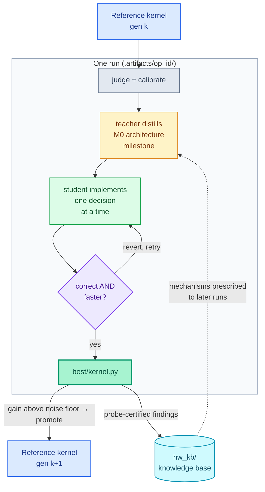
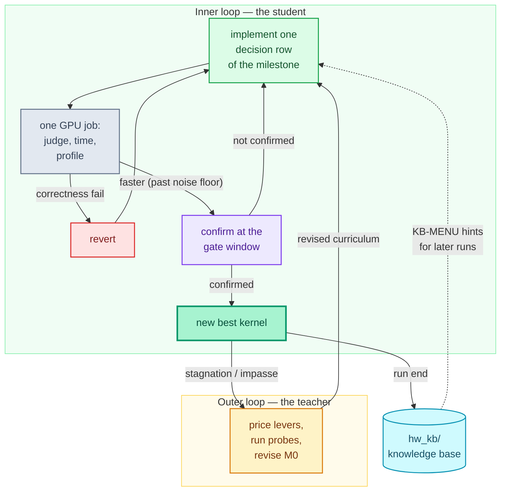

# RSI-Kernel-Tune

[](#1-quick-start)
[](#2-bring-your-own-operator)
[](docs/options.md)
[](LICENSE)
[](https://www.python.org)

RSI-Kernel-Tune pushes a GPU kernel's speed to the limit. You give it one operator: a
description, a correct reference implementation, and the input shapes you care about. A
**teacher** agent reads the reference's architecture and writes a milestone curriculum; a
**student** agent implements kernels against it; every candidate is judged by paired
measurement on real hardware, and every accepted kernel becomes the next run's reference —
so optimization keeps going past the best known implementation. Hardware-certified findings
accumulate in a knowledge base shared across operators.



*Color key: blue = reference; gray = measurement harness; amber = teacher; green = student; purple = go/no-go gate; teal = knowledge base.*

## Contents

1. [Quick start](#1-quick-start)
2. [Bring your own operator](#2-bring-your-own-operator) — the only part you write
3. [Configure the run](#3-configure-the-run) — optional; one file, mostly defaults
4. [Pick a lane](#4-pick-a-lane-optional) — optional; academic vs industrial
5. [Run it and get the result](#5-run-it-and-get-the-result)
6. [Command reference](#6-command-reference)
7. [Parameter reference](#7-parameter-reference) — every knob, every default
8. [How it works](#8-how-it-works)
9. [Advanced task options](#9-advanced-task-options)
10. [Repository layout and documentation](#10-repository-layout-and-documentation)
11. [Limitations](#11-limitations)
12. [License](#12-license)

## 1. Quick start

**Requirements.** The machine you run `rsi-kernel-tune` on: Linux or macOS, Python ≥ 3.11,
git, and the Claude Code CLI (logged in, or an `ANTHROPIC_API_KEY`). The GPU machine (the
same one, or an ssh host): an NVIDIA Hopper (`sm90`) or Blackwell (`sm100`) GPU, `python3`
with a CUDA build of PyTorch and, for CuTe DSL tasks, `nvidia-cutlass-dsl`; Nsight Compute
(`ncu`) is recommended, and without it a run proceeds on timings alone.

**1. Install**

```bash
cd RSI-Kernel-Tune                   # a clone of this repository
python3 -m venv .venv && source .venv/bin/activate
pip install -e .
rsi-kernel-tune --version            # rsi_kernel_tune 0.1.0
```

**2. Say where the GPU is** — `cp local.env.example local.env`, then:

```bash
# RKT_DELIVERY=local -> the GPU on this machine (RKT_GPU picks the device index)
# RKT_DELIVERY=ssh   -> REMOTE_HOST (an ssh alias that logs in without a prompt)
#                       and REMOTE_WORKDIR (a directory on it used only by runs)
# Also put the agents' credentials here (ANTHROPIC_API_KEY / CLAUDE_CODE_OAUTH_TOKEN),
# or a provider key such as GLM_API_KEY for provider = "glm" (section 3).
```

**3. Run the built-in example** — fuse a PyTorch RMSNorm into one kernel (`tasks/rmsnorm/`;
for your own operator, section 2 replaces this step):

```bash
rsi-kernel-tune new tasks/rmsnorm --dry-run          # check the task, print the plan
rsi-kernel-tune new tasks/rmsnorm                    # -> .artifacts/rmsnorm_<id>
rsi-kernel-tune run .artifacts/rmsnorm_<id>          # hours; safe to Ctrl-C and re-run
```

**4. Get the result**

```bash
rsi-kernel-tune export .artifacts/rmsnorm_<id>       # the confirmed best kernel's source
```

A finished run leaves `report.md` (what was tried, what won) and `best/kernel.py` under
`.artifacts/rmsnorm_<id>/`. `run` **exits 0** when the final confirmation meets the target
(1.2× the reference's device time by default) and **2** otherwise.

> 🤖 **Prefer an agent?** Paste this into Claude Code started in the clone, and it does
> steps 1–3: `Read README.md in this directory and set up RSI-Kernel-Tune on this machine:
> install it in a virtual environment, write local.env for my GPU (this machine, or the
> ssh host I name) and run `rsi-kernel-tune new tasks/rmsnorm --dry-run`. Show me the plan
> it prints.`

## 2. Bring your own operator

This is **the only part you write**. The framework needs three things: what the operator
computes, which input shapes to optimize for, and a correct implementation to start from.
One command scaffolds exactly those:

```bash
rsi-kernel-tune init myop            # -> tasks/myop/ with three files to fill in
```

**a. `tasks/myop/description.md` — what the operator computes.** The correctness judge is
written from this file alone, so be complete: signature, formula, every convention, what a
legal input looks like. A filled example (RMSNorm):

```markdown
## Signature
- inputs: `x` [m, n] bfloat16 (one row per token), `w` [n] bfloat16 (learned scale)
- output: `y` [m, n] bfloat16

## Semantics
For every row i: y[i,:] = x[i,:] / sqrt(mean_j(x[i,j]^2) + 1e-6) * w.
Mean and sqrt in float32; round to bfloat16 once at the end.

## Legal inputs
Any finite bfloat16 values; rows near zero must not produce NaN.
```

**b. `tasks/myop/shapes.json` — the shapes to optimize for.** Every entry is judged and
timed:

```json
[
  {"name": "small", "axes": {"m": 128,  "n": 4096}},
  {"name": "large", "axes": {"m": 8192, "n": 4096}}
]
```

**c. `tasks/myop/reference/run.py` — a correct implementation to beat.** Plain PyTorch is
fine (slower reference = bigger visible speedup):

```python
import torch

def run(x, w):
    xf = x.float()
    y = xf * torch.rsqrt(xf.pow(2).mean(dim=-1, keepdim=True) + 1e-6) * w.float()
    return y.to(x.dtype)
```

**That is all.** For pure speed optimization, `task.toml` needs no edits: the defaults are
beat-the-reference-by-1.2× on device time with a 4-hour loop budget. The only lines you may
want to change:

```toml
[task]
language = "cutedsl"   # or "cuda"
arch     = "sm100"     # "sm90" for Hopper
```

## 3. Configure the run

**One kernel, default provider: skip this section entirely.** Steps 1–2 of the quick start
plus your task are enough — defaults assume the Claude Code CLI's own login and run one
kernel.

Write one `rsi-run.toml` only when you want any of these: a non-default API provider or
model, several kernels optimized in parallel, a declared compute precision, or student
retrieval (section 4).

```bash
rsi-kernel-tune config init                  # writes a fully-commented rsi-run.toml
$EDITOR rsi-run.toml
rsi-kernel-tune run --config rsi-run.toml    # validates it, then runs every [kernel] in parallel
```

**Must fill** (the generated template marks them):

| Field | What to put |
|---|---|
| `[api] models` | Which model each role uses: `models = { teacher = "...", student = "..." }` |
| `[api] key_file` | The gitignored file holding the key, one `KEY=VALUE` per line (copy `local.env.example`). **Never the key itself in this file** — credential-looking keys are refused. |
| `[kernel] task` | The task directory (or a list): `task = "tasks/myop"` |

**Optional** (defaults shown):

| Field | Meaning | Default |
|---|---|---|
| `[api] provider` | `"native"` = the agent CLI's own login / credentials from `local.env`; or a table name from `global_config/backends.toml` (`base_url` / `wire` / `key_env`) — the shipped table has `[glm]` (key in `GLM_API_KEY`) | `native` |
| `[kernel] from_kernels` | Optimize a published kernel from `kernels/` instead (section 9) | — |
| `[precision] compute_dtype` | The dtype the kernel computes at: `fp32`/`tf32`/`bf16`/`fp16`/`fp8` (section 4) | `fp32` |
| `[student] retrieval` | `"on"` = the student may survey public sources before tuning (section 4) | `off` |
| `[run] parallel` | `"auto"` = one concurrent slot per kernel task; a number caps slots | `auto` |
| `[language]` | For a NEW language only: `name`, `syntax_docs`, `toolchain_config` (section 9) | — |

Priority when several places set the same thing:
`process environment > [api].key_file > local.env > global_config/ defaults`. Validation
happens at `run --config`: every problem names the one-line fix. The file names no secret
and is safe to commit.

## 4. Pick a lane (optional)

Both lanes use the same framework; the difference is one declaration.

| You are... | Set | What you get |
|---|---|---|
| **Academic** — capability numbers for a paper or benchmark | *Nothing. This is the default.* | The `STRICT` lane: memoization is forbidden, and the number measures the kernel's **honest compute**. These are the only numbers valid for paper claims. |
| **Industrial** — inputs repeat (same weights re-inferred, fixed datasets re-processed) | `memo_lane = true` in `tasks/<op>/task.toml`:<br>`[protocol]`<br>`memo_lane = true` | The `MEMO` lane: a judged input seen before *by value* returns the parked correct answer directly instead of recomputing (a hit is near-instant). Unseen inputs still compute honestly and pass the same correctness gate. The number means **serving latency on a repeating stream**; the two lanes' numbers are never compared. |
| **Industrial** — you want the best kernel fastest, no "from scratch" requirement | `retrieval = "on"` in `rsi-run.toml [student]` | The student surveys public sources first — SOTA write-ups, public implementations — and starts tuning from that context, reaching a strong kernel in fewer iterations. It still never sees *your* reference's source, and code seen online must not be copied. |
| **Any** — lower precision is acceptable | `compute_dtype = "bf16"` (or `tf32`/`fp16`/`fp8`) in `rsi-run.toml [precision]` | Optimizes at **exactly the declared precision, never below**; the fp64-truth error gate still judges every candidate. |

Details: [docs/industrial-lane.md](docs/industrial-lane.md) (two-lane contract),
[docs/compute-dtype.md](docs/compute-dtype.md) (precision contract).

## 5. Run it and get the result

```bash
rsi-kernel-tune new tasks/myop --dry-run             # check the task, print the plan
rsi-kernel-tune new tasks/myop                       # -> .artifacts/myop_<id>/
rsi-kernel-tune run .artifacts/myop_<id>             # run it / continue where it stopped
rsi-kernel-tune status                               # progress (every run)
rsi-kernel-tune export .artifacts/myop_<id>          # the best kernel's source
```

While it runs, `status` shows where the run is; `Ctrl-C` is safe and `run` continues from
where it stopped. Afterwards:

- `report.md` — every iteration, verdict and price, in one readable file
- `best/kernel.py` — the confirmed best kernel (`export` prints it, `--out file` writes it)
- `rsi-kernel-tune audit .artifacts/myop_<id>` — read-only per-verdict provenance (what the
  loop did and why)
- `rsi-kernel-tune harvest .artifacts/myop_<id>` — knowledge-base write-up of a *stopped*
  run (a normal run harvests automatically)

To keep going past the default target, self-evolution promotes each best kernel to the next
run's reference until the hardware gives no more:
`python scripts/self_evolve.py tasks/myop [--step 1.05] [--max-gen N]`.

## 6. Command reference

| Command | What it does |
|---|---|
| `rsi-kernel-tune init <op>` | Scaffold `tasks/<op>/` — the three files of section 2. |
| `rsi-kernel-tune init <op> --from-kernels --arch b200 --axes '<json>'` | Scaffold from a published kernel's frozen contract (`kernels/`), sealed as a black-box reference. `--arch` = `h100` or `b200`; `--axes` required. |
| `rsi-kernel-tune new tasks/<op> --dry-run` | Check the task and print the plan. Nothing runs. |
| `rsi-kernel-tune new tasks/<op>` | Create the run directory `.artifacts/<op>_<id>/`. |
| `rsi-kernel-tune run .artifacts/<op>_<id>` | Run it, or continue after an interruption. Exit `0` = target met; `2` = not. |
| `rsi-kernel-tune run --config rsi-run.toml` | Validate the run configuration, then run every `[kernel]` in parallel; exit `0` only if all met their targets. |
| `rsi-kernel-tune status [.artifacts/<op>_<id>]` | Where a run is (every run when omitted). |
| `rsi-kernel-tune export .artifacts/<op>_<id> [--out file]` | Print (or write) the best kernel's source. |
| `rsi-kernel-tune audit .artifacts/<op>_<id>` | Read-only per-verdict provenance report. |
| `rsi-kernel-tune harvest .artifacts/<op>_<id>` | Knowledge-base write-up of a stopped run. |
| `rsi-kernel-tune config init [--language <lang>] [--out <path>] [--force]` | Write the commented `rsi-run.toml` template (section 3). |
| `rsi-kernel-tune help internal` | Lower-level loop commands (`baseline`, `loop`, `window`, `monitor`, `submit`, …) — for debugging, not a second way to configure. |

## 7. Parameter reference

Everything below is **optional with a working default**; an unset key falls through to
`global_config/` (the bottom layer). Full details: [docs/options.md](docs/options.md).

**Per task (`tasks/<op>/task.toml`)**

| Knob | Meaning | Default |
|---|---|---|
| `[target] ratio` / `timing` | Stop when the kernel is this many × the reference (`ms =` sets an absolute target); time device or e2e | `1.2` / `device` |
| `[budget] hours` / `max_meta` / `reference_hours` | Loop wall clock; teacher revision rounds; hours to write a reference when there is none | `4` / `3` / `8` |
| `[task] language` / `arch` | Kernel language; target GPU | `cutedsl` / `sm100` |
| `[protocol] memo_lane` | The industrial MEMO lane (section 4) | `false` |
| `[protocol] sm_clock_mhz` / `mem_clock_mhz` | Declared measurement clock; the harness verifies the lock, refuses to time unlocked | unlocked |
| `[agent] model` / `effort`; `[agent.teacher]` / `[agent.student]` | Override the models/effort per role for this task | from `global_config/models.toml` |
| `[agent.teacher] prior_survey` / `prior_art` | Teacher surveys public SOTA and/or an offline dossier before distilling | `false` |
| `[loop] stagnation_k` | Non-improving rounds before forcing an architecture change | `3` |
| `[loop] floor_stop` / `floor_margin` | Stop once the analytic hardware floor is reached (within margin) | `false` (on for computable-floor tasks) |

**Loop / process (loop config and env)**

| Knob | Meaning | Default |
|---|---|---|
| `sprt_early_stop` | A clearly losing experiment ends early instead of sampling to the full window | on |
| `merge_eval_ncu` | Evaluation and profiling in one GPU job | on |
| `ncu_on_revert` | Whether reverted kernels are also profiled | on |
| `RKT_BUILD_CACHE=1` | Content-keyed build cache (~40% of job wall clock); hashes re-verified per hit | off |
| `RKT_BACKGROUND_LANE=1` | While the agent thinks, the GPU queues non-gate measurements | off |
| `RKT_PROFILE=baseline` | Turn every post-baseline verdict-changing mechanism off at once (emulates the upstream-era measurement behavior, for audits) | unset |

**Infrastructure (`local.env` + env)**

| Knob | Meaning |
|---|---|
| `RKT_DELIVERY` / `RKT_GPU` | Where the GPU is (local / ssh host) and which device index |
| `ANTHROPIC_API_KEY` / provider key env | The agents' credentials (from your key file / `local.env`) |

## 8. How it works



A run has two nested loops. In the **inner loop** the student implements one decision row of
the milestone at a time; one GPU job judges correctness, times the candidate against the
reference in a mirror-ordered paired window, and profiles it; a correctness failure is
reverted, and machine faults never count as verdicts. In the **outer loop** the teacher
re-enters after iterations without a new best, at an exhausted decision graph or at a gate
impasse: it prices levers, runs verdict probes, and revises the curriculum — including
revising M0 itself when only a new structure can lift the limit.

Three artifacts carry the work, and their boundary is what keeps the reference's code out
of the kernel: the per-operator **milestone** (decisions and contracts, never an
implementation body), the **hardware knowledge base** `hw_kb/` (operator-agnostic
mechanisms, the only artifact with code), and the **meta-milestone**
(`meta_milestone.md`, the distillation policy).

| Concept | In this repository |
|---|---|
| teacher agent | `[agent.teacher]` in `task.toml` / `models.teacher` in `rsi-run.toml` |
| student agent | `[agent.student]` / `models.student` |
| a run ("campaign") | `.artifacts/<op>_<id>/` |
| knowledge base | `hw_kb/cutedsl/`, `hw_kb/cuda/`, by GPU architecture |

Two things are **not** knobs: the anti-cheat contract (the student never sees the
reference's source or any optimized implementation — no switch exists; the MEMO lane's
cache is a production feature with a correctness door, not a way to see answers) and the
measurement math (paired windows, the error-ratio gate) — they are why a win here is
trustworthy.

## 9. Advanced task options

**Reference modes** — the `[reference]` table in `task.toml` decides what the teacher sees:

| `[reference]` | Mode | What the teacher sees |
|---|---|---|
| `run` + `source` | `source` | the reference's source and its hardware behavior |
| `run` only, or `blackbox = true` | `blackbox` | hardware behavior only (the source is sealed) |
| (no `[reference]` table) | generate | a `/goal` session writes a reference first |

**Published-kernel corpus** — `kernels/` releases 25 kernels across H100 and B200
(upstream artifact release, honest provenance records). They are prior/teaching material,
and via `init --from-kernels` also the framework's own task corpus:

| Directory | Operators |
|---|---|
| `attention/` | attention backward (MHA, GQA-8), attention forward (GQA-16), GQA paged decode, MLA paged decode, MLA paged prefill |
| `sparse_attention/` | DeepSeek sparse attention backward, score recompute, indexer backward; DeepSeek-V4.1 fused attention-RoPE-cast |
| `linear_attention/` | Gated DeltaNet prefill (forward, backward, varlen); recurrent Kimi Delta Attention prefill |
| `gemm/` | dense FP16 GEMM, FP8 GEMM, FP8×FP4 grouped GEMM (MoE) |
| `conv/` | Conv2d weight and data gradient, Conv3d forward |

Each kernel's speedup and comparison target: [kernels/README.md](kernels/README.md).

**A new language** needs more than the `[language]` section of the run config: a prompt
overlay in `meta/<lang>/` and a knowledge-base tree `hw_kb/<lang>/<arch>/` — see
[docs/run-configuration.md](docs/run-configuration.md). Language registration is a code
change by design.

## 10. Repository layout and documentation

```text
src/rsi_kernel_tune/  the harness: CLI, tasks and runs, the loop, GPU jobs
global_config/        the bottom config layer: models.toml, loop.toml, backends.toml
tasks/                <op>/: task.toml, description.md, shapes.json, reference/;
                      _template/ (what `init` copies), rmsnorm/ (ready to run)
.artifacts/           runs, gitignored: <op>_<id>/{run.json, ws/, report.md, best/, ...}
skills/               the agents' tools, one SKILL.md + scripts each
meta/                 teacher and student prompts (meta/cuda/: CUDA C++)
hw_kb/                the hardware knowledge base (cutedsl/, cuda/), by GPU architecture
kernels/              the published-kernel corpus, by operator family
operators/            per-operator card trees (loop.toml layer), generated per run
docs/                 design notes, configuration and knob references, KB discipline
scripts/              agent launcher, /goal driver, self-evolution, backtests
tests/                pytest suite (CPU only)
```

Tests run without installing: `python3 -m pytest tests/ -q` (`pyproject.toml` sets
`pythonpath=["src"]`).

- [docs/README.md](docs/README.md) — one-line-per-document index
- [docs/options.md](docs/options.md) — every knob, all three layers, rollback switches
- [docs/run-configuration.md](docs/run-configuration.md) — the run configuration, field by field
- [docs/industrial-lane.md](docs/industrial-lane.md) / [docs/compute-dtype.md](docs/compute-dtype.md) — the two contracts of section 4
- [docs/blackbox-mode.md](docs/blackbox-mode.md) — sealed references and the guard
- [docs/kb-harvest.md](docs/kb-harvest.md) — how certified recipes enter the knowledge base
- [CHANGELOG.md](CHANGELOG.md) — release history; [docs/backlog.md](docs/backlog.md) — frozen/deferred proposals
- Paper: TBD — the experiment bundle lands under [docs/paper/](docs/paper/)

## 11. Limitations

- **A reference helps most.** Given only a PyTorch implementation and a device-time number,
  the upstream ablation stalls; this framework surpasses an implementation that exists more
  reliably than it writes the first one.
- **A plateau is an estimate, not a proof.** Self-evolution stops at the same-job noise
  floor: the loop found nothing more, which does not mean nothing more exists.
- **Coverage.** The corpus and defaults target NVIDIA Hopper and Blackwell in CuTe DSL and
  CUDA C++; other languages, vendors and archs need the registration steps in
  [docs/run-configuration.md](docs/run-configuration.md).
- **Cost.** A run is hours of GPU time and frontier-model usage, and the agents run with
  permissions bypassed inside a policy the driver writes; run it on a machine meant for it.

## 12. License

Apache-2.0 — see [LICENSE](LICENSE). This repository is a fork of
[OpenBMB/ForgeKernel](https://github.com/OpenBMB/ForgeKernel); see [NOTICE](NOTICE).

<!-- SPDX-FileCopyrightText: Copyright 2026 The RSI-Kernel-Tune Authors -->
<!-- SPDX-License-Identifier: Apache-2.0 -->
