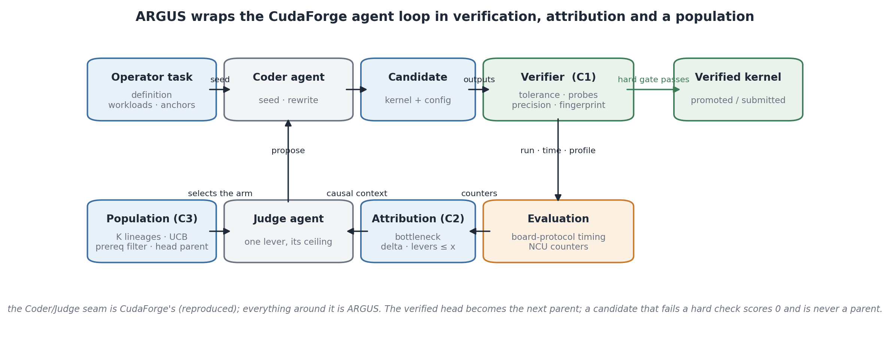

<div align="center">

# ARGUS: What an agentic kernel generator must verify, and what its search must respect

[](../LICENSE)
[](pyproject.toml)
[](tests/)
[](docs/design/architecture.md)



</div>

Large language models can now write GPU kernels that run, and some of them are fast.
The harder question is whether they are *right*, and whether the search that produced them
was aiming at the right thing. This repository studies both questions on top of a
deliberately conventional agent loop — **CudaForge**'s Coder/Judge iteration with Nsight
Compute feedback — and reports what happens when the two assumptions that loop rests on are
removed: that a single `allclose` on a single shape certifies a kernel, and that an
optimisation step never makes the next step worse.

We call the resulting system **ARGUS**. It is a reference implementation of three claims. All
three are checked *in simulation* on a CPU — emulated kernels on a synthetic landscape — so the
reasoning can be falsified without a GPU, and every number below is from that simulator, not
from hardware:

- **A generator's objective is only as good as its gate.** In the simulator, each of four
  reward-hack families (precision narrowing, shape specialisation, memoisation, faked timing)
  passes a re-implementation of CudaForge's single-shape `allclose` gate, and none passes the
  six-layer gate; held at equal evaluation budget, the simulator's effective score for the same
  loop moves from **0.00 to 0.65** once the gate is the studied metric's rather than `allclose`.
- **A single chain cannot recover from an unrecoverable mistake.** On a synthetic landscape
  where mechanisms must be applied in an order (a layout before a tensor-core op), an unordered
  chain settles at a permanently reduced ceiling, while a prerequisite-aware population reaches
  the landscape optimum on every seed (**0.94** vs **0.79** for the chain).
- **Profiler feedback should be causal, not a dump.** The raw counter block carries no
  statement of what changed or what it is worth; attribution turns the counters into a
  bottleneck, a delta with an unexplained-speedup flag, and a bounded lever list — and refuses
  mechanisms the model says cannot pay off before a GPU evaluation is spent on them.

None of this is a new kernel, and none of it is a hardware result yet. It is a study of the
surrounding machinery, carried as far as a simulator allows. The GPU experiments that would
turn these simulator predictions into measurements are specified, ordered, and deliberately
**not** run: see [`docs/experiments.md`](docs/experiments.md). What the simulation does and
does not establish is stated in [*What this simulator does and does not show*](#what-this-simulator-does-and-does-not-show).

## Status

- **2026-11** — repository created. CudaForge's loop (state machine, prompt contracts,
  parsers), the six-layer verifier, the attribution model and the population search are
  implemented and checked on CPU (53 tests, three runnable experiments). No hardware run yet.
- **2026-11** — local ablation reported in [`docs/design/findings.md`](docs/design/findings.md):
  gate choice and search structure each move the studied metric substantially, and they are
  separable.
- **next** — the GPU protocol in [`docs/experiments.md`](docs/experiments.md): five nested
  studies, from verification alone to a full-corpus run, each with a falsification criterion.

## Research questions

**RQ1 — Verification.** For a kernel generator whose objective is measured speed, what does a
correctness gate have to check before the objective stops rewarding failures? Which classes of
incorrect-but-fast kernel survive the gate a standard agentic system uses?

**RQ2 — Search structure.** Given that a kernel's mechanisms interact and some orderings are
irreversible, does the population/lineage structure of the search matter independently of the
verification gate — and by how much at equal evaluation budget?

**RQ3 — Feedback signal.** Does presenting the judge a *causal* account of the counters
(what moved, what it explains, what is left, at what ceiling) produce better proposals per
evaluation than presenting the raw counter block?

## Findings

All three are simulator results. They establish that the mechanisms *can* be separated and that
the checks catch what they claim to catch on the constructed cases; they do not establish any
magnitude on real kernels.

**F1 — the gate, not the generator, decides whether a fast kernel counts.** We implement four
hack families as emulated kernels — precision narrowing, shape specialisation, memoisation, and
a faked measurement — chosen because the benchmark's own screening is known to flag them. In the
simulator, all four pass a re-implementation of CudaForge's single-shape `allclose` at `1e-3`,
and none passes the six-layer gate (`docs/assets/figure2-verification.png`,
`python -m argus.cli hacklab`). The honest emulated kernel passes both, so the gate is not
merely strict. This is the premise of the GPU study, not a substitute for it.

**F2 — a chain's ceiling loss is structural, not statistical.** On a synthetic landscape where
prerequisite-ordered mechanisms lock if applied out of order, a round-robin chain converges to a
stable but permanently reduced ceiling; adding a population, a UCB over mechanisms and a
prerequisite filter recovers the landscape optimum on every seed at the same evaluation budget
(`docs/assets/figure3-ablation.png`, `python -m argus.cli ab`). The landscape encodes the
interaction by assumption, so this result is conditional on the assumption being physically
real — which is what Study B in the protocol is designed to test.

**F3 — counters under-determine their own explanation.** In the model, a latency change that no
counter movement can account for is detectable, and is the cheapest available signal that a
candidate was measured rather than improved. The attribution layer separates explainable from
unexplainable deltas and the pre-screen refuses mechanisms whose model bound is below the noise
floor; both are unit-tested, and both are cheap. Whether real counter traces contain the same
signal is untested.

Each finding's simulator experiment has a stated outcome that would refute it; the GPU studies
in [`docs/experiments.md`](docs/experiments.md) carry the corresponding falsification criteria
for the hardware claims.

## What this simulator does and does not show

The local experiments run the real verification, attribution and search code, but on inputs
that are not CUDA kernels:

| what is simulated | what is real |
|---|---|
| the candidate kernels: numpy functions that emulate a correct kernel and four hack families | the six verification layers and their decision logic |
| the device time and the counter snapshots: generated by a landscape model | the attribution arithmetic, the flags, the pre-screen bounds |
| CudaForge's `allclose` gate: re-implemented from its documented rule (`atol = rtol = 1e-3`, one shape), not executed from upstream | the search loop, the UCB, the lineage bookkeeping, the promotion rule |
| the optimisation landscape and its prerequisite structure | the budget accounting and the A/B design |

So the simulator can show that a check fires, that a search structure changes where evaluations
go, and that a loop's score depends on its gate. It cannot show that tf32 accumulation is
actually emitted by a model, that a real kernel's ceiling is irreversibly lost by an out-of-order
mechanism, or that any speedup is achievable. Those are the GPU studies, and their numbers will
be reported only from paired measurements under the benchmark's protocol.

## How it works

A run keeps CudaForge's two agents and changes only what surrounds them. The Coder writes a
candidate; a six-layer verifier gates it; an evaluation returns a device time and a counter
snapshot; attribution turns the snapshot into one lever with a ceiling; the Judge reads that
lever; and a population decides which lineage and which mechanism produce the next candidate,
always from a verified head rather than the latest step. A candidate that fails a hard check
scores nothing and never becomes a parent.

Three artifacts carry the work, and their boundary is what keeps the study honest: the
**verification stack**, which decides what counts; the **attribution model**, which decides
what the judge is told; and the **search**, which decides where the next evaluation goes. The
concepts map onto the code as follows.

| Concept | In this repository |
|---|---|
| the reproduced agent loop | `src/argus/cudaforge.py` (`run_cudaforge_loop`, `run_argus_loop`) |
| the single chain we compare against | `src/argus/search.py::greedy_chain` |
| verification gate (C1) | `verifier.py`, `probes.py`, `fingerprint.py` |
| attribution and pre-screen (C2) | `attribution.py`, `roofline.py` |
| population search (C3) | `search.py::PopulationSearch` |
| the metric we study | `objective.py`; see [`docs/metric.md`](docs/metric.md) |

> Design rationale → [`docs/design/architecture.md`](docs/design/architecture.md) ·
> findings and their status → [`docs/design/findings.md`](docs/design/findings.md)

## What is validated where

| | checked here (simulator / unit tests) | needs hardware |
|---|---|---|
| the six verification layers, on emulated hacked kernels | ✅ decisions fire as specified | whether models emit these hacks in practice |
| attribution arithmetic and pre-screening bounds | ✅ against constructed counter cases | whether real traces carry the same signal |
| search A/B (chain vs population) | ✅ synthetic landscape | whether real mechanism interactions are irreversible |
| the Coder/Judge loop logic (state machine, parsers, budgets) | ✅ mock backend | agent quality and real kernels |
| the metric algebra and its inversion | ✅ | the measurement itself |

Nothing in the left column is a hardware measurement. The right column is
[`docs/experiments.md`](docs/experiments.md).

The synthetic landscape is honest about its own limits: it validates the *logic* of F2, not a
hardware magnitude. The GPU protocol is written down rather than assumed.

## Quick start (no GPU, no model)

```bash
cd argus
export PYTHONPATH=src
python3 -m argus.cli selftest                 # consistency of the algebra and constants
python3 -m argus.cli hacklab --seed 1         # F1: which gate accepts which kernel
python3 -m argus.cli attrib                   # F3: attribution and pre-screen
python3 -m argus.cli ab --seeds 6 --evals 40  # F1/F2: the equal-budget ablation
python3 -m argus.cli dryrun                   # the production adapter, no GPU
bash scripts/local_validate.sh                # all of the above + 53 unit tests
python3 scripts/make_figures.py               # regenerate docs/assets/*.png
```

Requirements: Python ≥ 3.9, `numpy`, `matplotlib` (figures only). No torch, no GPU.

## Repository layout

```text
src/argus/          the system: loop, verification, attribution, search, backends
  backends/         mock (CPU testbed), CudaForge adapter (dry-run validated)
configs/            an example run configuration
experiments/        the three local experiments, runnable
docs/
  design/           architecture and findings
  metric.md         the objective we study and where its anchors come from
  experiments.md    the GPU protocol and its falsification criteria
  assets/           figures (regenerated by scripts/make_figures.py)
data/               a live public snapshot of the benchmark structure
scripts/            bootstrap, local_validate, fetch_board, make_figures
tests/              pytest suite (CPU only)
vendor/             upstreams at pinned commits (gitignored; scripts/bootstrap.sh)
```

## Related work

ARGUS is a study of the machinery around kernel generation, not a new method for generating
kernels, and it sits next to several lines of work. **CudaForge** is the loop we reproduce,
chosen because it is small, training-free and already reads profiler feedback. **ForgeKernel**
(a sibling study of a different question) argues that architectural planning should be
separated from coding and that accepted kernels should become the next reference; ARGUS takes a
different axis — verification and search structure — and depends on none of its mechanisms.
The **KernelBench-Verified** and correctness-audit literature documents how fixed-shape,
single-tolerance checks certify incorrect kernels, which is the empirical premise of RQ1.
**SOL-ExecBench** supplies the metric and its anchors. None of these is a baseline we claim to
beat on kernel speed; they are the context in which the questions are posed.

## Limitations

- **The synthetic landscape is a model.** It encodes interaction and irreversibility to study
  search structure; its magnitudes are not hardware. F2 is a claim about *structure* until the
  GPU protocol confirms the interactions are real.
- **The prerequisite table is declared, not learned.** It encodes known ordering constraints;
  a wrong entry would mis-filter arms. It is reviewed per architecture, and Study B has a
  criterion that would retire it if real mechanisms turn out to be commutative.
- **The verification win is conditional on the hack families being realistic.** They are drawn
  from the board's own flagged classes and a published ablation; a genuinely new hack family
  would need a new check.
- **The production adapter's live paths are written but only dry-run-validated.** The protocol
  doc lists the checklist that would promote them to measured.
- **Coverage.** Norm-, GEMM- and attention-like operators on Blackwell; other memory
  hierarchies and sparsity patterns are untested.

## Open questions

- [ ] **Does the causal block change proposals, or only the prose?** Study C measures
  evaluations-to-target with the causal block against the raw dump; a null result would mean
  the judge already performed the attribution implicitly.
- [ ] **Which mechanisms are actually irreversible on `sm_100a`?** The prerequisite table is
  the most falsifiable assumption in the system; Study B probes it directly.
- [ ] **Does the gate transfer?** Precision and shape-specialisation hacks are language
  independent; whether the same six layers certify Triton and CuTe DSL candidates is open.
- [ ] **Fusion, beyond mechanism tuning.** The structural ceiling is choosing which
  neighbouring operators to absorb; not implemented, and the largest open risk.

## Contributing

Corrections, counter-examples and new hack families are the most useful contributions: the
verification catalogue and the landscape model are both meant to be argued with. Run
`bash scripts/local_validate.sh` before sending a change; the suite needs no GPU. A new
verification layer needs a kernel that passes the current gate and fails the new one.

## Acknowledgments

Built on [CudaForge](https://github.com/OptimAI-Lab/CudaForge) (the reproduced loop),
[Nsight Compute](https://developer.nvidia.com/nsight-compute) (the counters),
[SOL-ExecBench](https://huggingface.co/datasets/nvidia/SOL-ExecBench) (the metric and anchors)
and [FlashInfer-Bench](https://huggingface.co/datasets/flashinfer-ai/flashinfer-trace) (the
operator traces). The correctness-audit literature and
[ForgeKernel](https://github.com/OpenBMB/ForgeKernel) shaped the questions, not the code.

## License

MIT. See [`../LICENSE`](../LICENSE). The upstreams ARGUS builds on are MIT (CudaForge) and
Apache-2.0 (SOL-ExecBench, FlashInfer-Bench); they are vendored at pinned commits and not
redistributed here.
